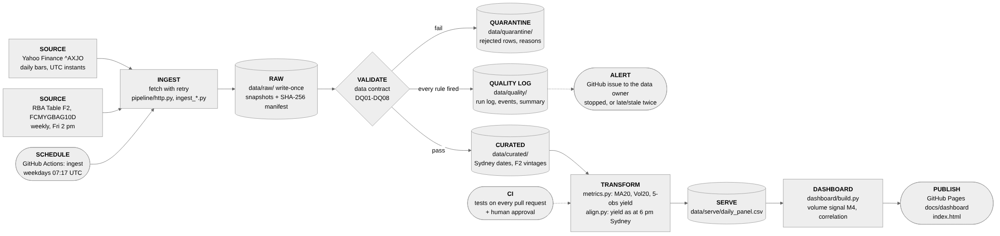

# Architecture

Drafted by Claude (AI agent) on 1 Nov 2026 from the code as built; the team checks it before using it in the report. The diagram source is [`architecture.mmd`](architecture.mmd) (Mermaid); the picture is [`img/architecture.png`](img/architecture.png).

## Layers

| Layer | Where | What it does | What it never does |
| --- | --- | --- | --- |
| Schedule | `.github/workflows/ingest.yml` | Runs the pipeline on weekdays at 07:17 UTC (18:17 Sydney in daylight time), or by hand with an optional failure simulation | Run on weekends; overlap with itself (`concurrency: ingest`) |
| Ingest | `pipeline/http.py`, `pipeline/ingest_yahoo.py`, `pipeline/ingest_rba_f2.py` | Downloads both sources with retries and backoff (429, timeouts, 403) | Change what it downloaded |
| Raw | `data/raw/<source>/<date>/` | Keeps each download exactly as received, with a manifest (URL, size, SHA-256, time) | Get edited or overwritten |
| Validate | `pipeline/validate.py`, `config/dq_rules.yaml` | Checks the data contract and rules DQ01–DQ08; every rule that fires is logged | Drop a record silently |
| Quarantine | `data/quarantine/` | Holds rejected rows, and whole snapshots when the contract breaks, with the reason | Feed the dashboard |
| Curated | `data/curated/` | One row per Sydney trading date (ASX) or RBA date; F2 vintages with the time each value could first be known | Hold calculated metrics |
| Quality log | `data/quality/` | Run log (status per source per run), events, a readable summary; an issue opens for the data owner when a load stops, or is late or stale twice | Hide a failure behind a green run |
| Transform | `pipeline/metrics.py`, `pipeline/align.py` | The three metrics on the team's definitions (`docs/METRICS.md`); one Sydney time axis; the yield as known at the 6 pm review (point in time) | Use a yield before the RBA published it |
| Serve | `data/serve/daily_panel.csv` | The one table the dashboard reads (contract tests in `tests/test_serve_contract.py`) | Change shape without a test failing |
| Dashboard | `dashboard/` → `docs/dashboard/` | Volume signal (M4) and correlation; one page, rebuilt after every real run | Recalculate the Part 2 metrics |
| CI | `.github/workflows/ci.yml` | Validates workflow files and runs every test on each pull request; a team member approves before merge | Merge on its own |

## Storage is separate from transformation

Raw, quarantine and curated files are written only by the ingest step; transforms read curated data and write only `data/serve/`. The serve table can be rebuilt at any time with `python -m pipeline.align` without downloading anything, and a failed download never changes a clean table (simulations are labelled and kept out of the curated data).

## Time

Yahoo stamps each bar with a UTC instant; it is converted to a Sydney trading date before anything else. The RBA publishes F2 weekly (Fridays, 2 pm Sydney), so each yield carries `available_from_syd`, and the serve table joins the latest yield *available* at 6 pm Sydney, with its age in sessions. See `docs/DATA_DICTIONARY.md` and `docs/RUNBOOK.md`.
